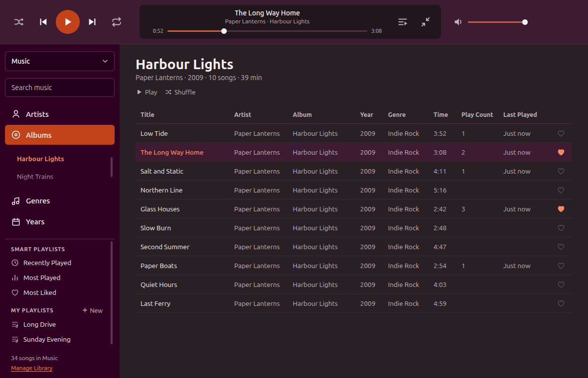

# Music

A fast desktop music player for Ubuntu, built for people who keep their own music collection. It plays the files in a folder you choose, with no account, no streaming and no store.



## Features

- **Browse your way:** go through Artists, Albums, Genres or Years. Artist names ignore "The", so The Antlers sorts under A.
- **Built for big libraries:** tested with about 12,000 songs. After the first scan it opens in around a second.
- **Separate libraries for Music, Podcasts and Audiobooks:** anything tagged with the genre `Podcast` or `Audiobook` gets its own visual library, with covers and progress bars. It stays out of Shuffle All and your smart playlists, and it remembers your place.
- **Playlists:** make your own, plus Recently Played, Most Played and Most Liked, which fill themselves in.
- **Up Next:** right-click any song and choose Play Next.
- **Mini player:** shrink the app to a slim bar with all the controls.
- **Shuffle and repeat:** repeat one song or a whole list, and mark songs to skip when shuffling.
- **Favourites, play counts and last played dates.**
- **Select several songs:** Ctrl-click, Shift-click or Ctrl-A, then act on them all from the right-click menu.
- **Album covers:** read from your files when something is playing or an album is open.
- **Sync your iPod:** plug in a click wheel iPod, tick what goes on it, and sync. It adds and removes songs so the iPod matches, and brings its play counts back. See [Syncing an iPod](#syncing-an-ipod) first.
- **Edit tags and covers (MP3):** change one song or a whole selection, or strip a file's tags and start again. Play counts, favourites and playlists stay with the song.

Supports MP3, FLAC, Ogg, Opus, M4A and WAV.

## Install

Download the `.deb` file from the [latest release](https://github.com/underatram/music-player/releases/latest), then run this from the folder you saved it in:

```bash
sudo apt install ./music-player_0.17.0_amd64.deb
```

It's built for 64-bit Intel and AMD computers. It's been tested on Ubuntu with GNOME on Wayland, and other Debian-based systems may work too.

## Syncing an iPod

This is new and has only been tested on one iPod classic, so back up anything that exists only on your iPod first.

- **A sync makes the iPod match what's ticked.** Any song on the iPod that isn't ticked or in your library is deleted from the iPod. You see exact numbers and confirm before anything is removed, and the files in your library aren't touched.
- **MP3 only so far.** Your own playlists don't go across yet, and podcasts and audiobooks appear as ordinary songs on the iPod.
- **Eject before unplugging**, using the button next to your iPod under Devices.

Newer iPods that don't show up as a drive, such as the iPod touch, aren't supported. If the app can't identify your model, it won't write to it. Running `sudo ipod-read-sysinfo-extended <bus> <device> <mount>` once may help, using the numbers from `lsusb`.

## Your files and privacy

- **Your music is only changed when you ask.** The app just reads your folder unless you save an edit, and it replaces a file only after checking the new copy.
- **Nothing leaves your computer.** The app has no accounts or tracking, and it doesn't connect to the internet.
- **Your data stays local.** Favourites, play counts and playlists are saved in `~/.config/music-player/library-data.json`. Back that file up if you want to keep them.
- **Editing and syncing are the only things that change files**, and only when you press Save or Sync. Copies of your iPod's song list are saved in `~/.config/music-player/ipod-backups`.

## Adding music

Copy new music into your folder using your file manager, then choose **Manage Library > Scan Folder for Changes**. The app also checks for changes each time it opens.

## Organising your music

The app reads the tags in your files. If a file has no tags, it works out what it can from a folder layout like this:

```
Genre (12)/Artist/[1997] Album/01 Title.mp3
```

## Keyboard shortcuts

| Key | Action |
|---|---|
| Space | Play or pause |
| `/` | Search |
| Ctrl-A | Select every song in the list |
| Esc | Clear the search or selection, or close Up Next |

## Run from source

You'll need [Node.js](https://nodejs.org).

```bash
git clone https://github.com/underatram/music-player.git
cd music-player
npm install
npm start
```

To build the installer, you'll also need `gcc`, `pkg-config` and `libgpod-dev`. Then run `npm run dist`. It's saved in the `dist` folder.

The app is plain HTML, CSS and JavaScript with no build step, wrapped in [Electron](https://www.electronjs.org).

## Licence

[MIT](LICENSE). The bundled Ubuntu font has [its own licence](fonts/LICENCE.txt).

This is an independent project, not affiliated with or endorsed by Canonical or the Ubuntu project.
